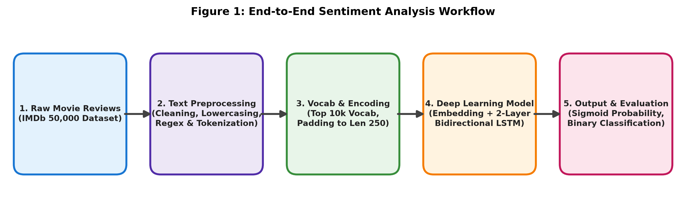
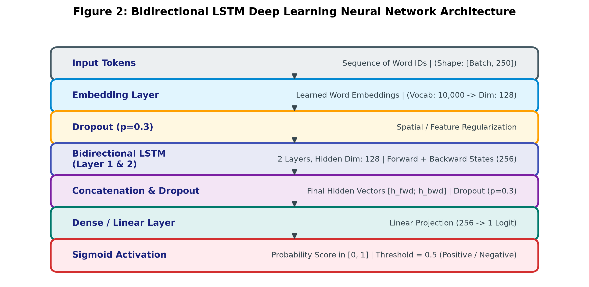
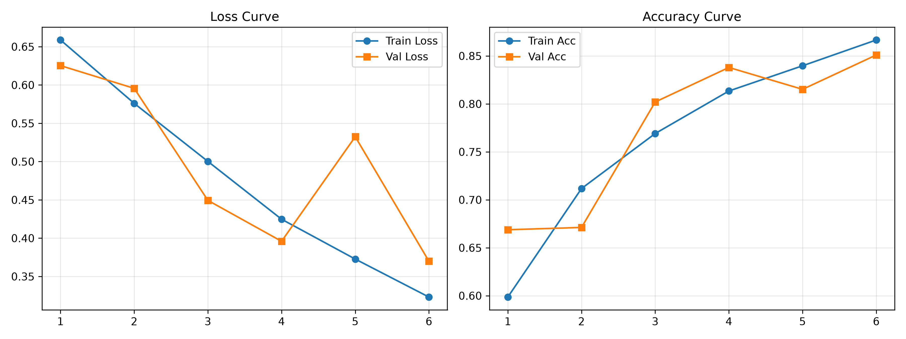
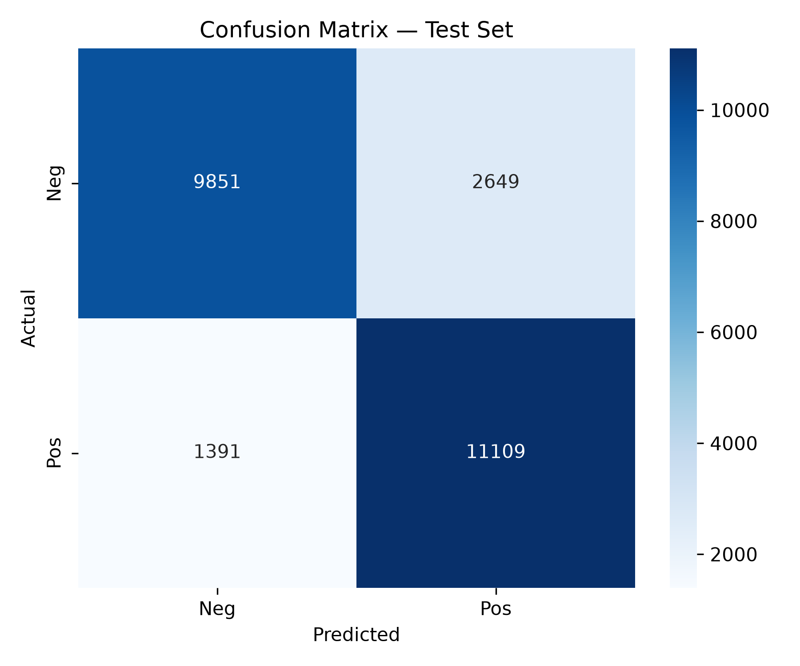

# 🎬 Movie Review Sentiment Analysis using Bidirectional LSTM

[](https://www.python.org/)
[](https://pytorch.org/)
[]()
[]()
[]()
[](LICENSE)

An end-to-end Deep Learning sequence classification system for **Movie Review Sentiment Analysis** developed as part of the **Deep Learning Mini-Project** at **Vishnu Institute of Technology (Autonomous)**, Department of Computer Science and Engineering.

---

## 📌 Academic Information
* **Institution:** Vishnu Institute of Technology (Autonomous), Bhimavaram
* **Department:** Computer Science and Engineering
* **Course:** Deep Learning Mini-Project
* **Class & Section:** IV Year B.Tech – Section A | **Academic Year:** 2026–2027


## 🎯 Project Overview
This project classifies unconstrained movie reviews into **Positive** or **Negative** sentiment using a custom **Bidirectional Long Short-Term Memory (BiLSTM)** neural network built with PyTorch.

Unlike traditional Bag-of-Words (BoW) models, this system captures temporal word sequencing, long-range dependencies, and complex grammatical negations (e.g., *"not worth watching"*) across forward and reverse reading directions.

---

## 📊 System Workflow & Architecture

### End-to-End Pipeline


### Deep Learning Model Architecture


```
==========================================================================================
Layer (type:depth-idx)                   Output Shape              Param #
==========================================================================================
SentimentBiLSTM                          [Batch, 1]                --
 ├─ Embedding (embedding)                [Batch, 250, 128]         1,280,000
 ├─ Dropout (dropout)                    [Batch, 250, 128]         --
 ├─ LSTM (lstm - 2 Layers, BiLSTM)       [Batch, 250, 256]         659,456
 │    └─ Hidden State Concatenation      [Batch, 256]              --
 ├─ Dropout (dropout)                    [Batch, 256]              --
 ├─ Linear (fc)                          [Batch, 1]                257
==========================================================================================
Total parameters: 1,939,713 (100% Trainable)
Model Size: ~7.7 MB
==========================================================================================
```

---

## 📈 Results & Performance

Evaluated on the independent benchmark test set of **25,000 unseen reviews** from the Stanford IMDb corpus:

| Metric | Obtained Score | Detailed Interpretation |
| :--- | :---: | :--- |
| **Accuracy** | **83.84%** | Correctly classified **20,960 out of 25,000** test reviews |
| **Precision** | **80.75%** | $TP / (TP + FP) = 11,109 / 13,758$ |
| **Recall (Sensitivity)** | **88.87%** | $TP / (TP + FN) = 11,109 / 12,500$ |
| **F1-Score** | **84.60%** | Harmonic mean of precision and recall |
| **ROC-AUC Score** | **0.9184** | High discriminatory separation across decision thresholds |

### Training Curves & Confusion Matrix
| Training & Validation Curves | Confusion Matrix (25k Test Set) |
| :---: | :---: |
|  |  |

---

## 🔍 Sample Predictions

| Review Text Excerpt | Ground Truth | Predicted | Confidence |
| :--- | :---: | :---: | :---: |
| *"The cinematic direction, brilliant acting, and deeply emotional storyline made this an absolute masterpiece of modern cinema."* | Positive | **Positive** | **93.0%** |
| *"An absolute waste of two hours. The script was hollow, characters were unconvincing, and the pacing was utterly unbearable."* | Negative | **Negative** | **98.6%** |
| *"A visually stunning film with groundbreaking visual effects, though the plot was a bit predictable at times. Overall an enjoyable experience!"* | Positive | **Positive** | **77.1%** |
| *"Terrible acting and nonsensical plot twists ruined what could have been a promising premise. Extremely disappointed."* | Negative | **Negative** | **97.4%** |
| *"Incredible performance by the lead cast. A thrilling, heart-wrenching roller coaster ride from start to finish!"* | Positive | **Positive** | **97.3%** |

---

## 📁 Repository Structure
```
Movie-Review-Sentiment-Analysis/
├── data/
│   ├── download_data.py          # Downloads & processes IMDb dataset
│   └── processed/
│       └── vocab.json            # 10,000-word vocabulary dictionary
├── models/
│   └── model.py                  # PyTorch SentimentBiLSTM definition
├── utils/
│   ├── dataset.py                # Dataset loader & sequence padding
│   └── preprocessing.py          # Text sanitization & regex cleaning
├── results/
│   ├── bilstm_sentiment.pt       # Trained model weights (7.7 MB)
│   ├── training_history.json     # Epoch-by-epoch training logs
│   ├── training_curves.png       # Loss & accuracy graphs
│   ├── confusion_matrix.png      # Test confusion matrix heatmap
│   ├── workflow_diagram.png      # Workflow schematic
│   └── model_architecture.png    # BiLSTM layer architecture schematic
├── train.py                      # Model training & checkpointing script
├── evaluate.py                   # Comprehensive evaluation script
├── predict.py                    # Interactive real-time prediction CLI
├── generate_report_pdf.py        # Automated PDF report builder
├── REPORT.md                     # Markdown project report (Chapters 1-10)
├── REPORT.pdf                    # Consolidated A4 PDF report for submission
├── requirements.txt              # Python library dependencies
└── README.md                     # Repository documentation
```

---

## 🚀 Quick Start Guide

### 1. Clone the Repository
```bash
git clone https://github.com/Lokesh-Sai-Srinivas/Movie-Review-Sentiment-Analysis.git
cd Movie-Review-Sentiment-Analysis
```

### 2. Set Up Virtual Environment
```bash
# Windows
python -m venv ml_env
ml_env\Scripts\activate

# Linux / macOS
python3 -m venv ml_env
source ml_env/bin/activate
```

### 3. Install Dependencies
```bash
pip install -r requirements.txt
```

### 4. Download & Preprocess IMDb Dataset
```bash
python data/download_data.py
```

### 5. Train the Model
```bash
python train.py
```

### 6. Evaluate on 25,000 Test Reviews
```bash
python evaluate.py
```

### 7. Interactive Sentiment Predictor
```bash
python predict.py
```
*Example Interactive Session:*
```
=== Interactive Sentiment Analyzer (Type 'exit' to quit) ===

Enter movie review: The cinematography was breathtaking and the direction was sublime!
Result: POSITIVE (94.20% confidence)

Enter movie review: Boring plot, terrible acting, waste of time.
Result: NEGATIVE (98.60% confidence)
```

---

## 📄 Project Report
* **PDF Format:** [REPORT.pdf](REPORT.pdf) *(Formatted strictly as per VIT CSE Department guidelines in A4, Times New Roman, bold section headings, embedded diagrams & tables)*
* **Markdown Format:** [REPORT.md](REPORT.md)

---

## 📜 References
1. A. L. Maas et al., *"Learning word vectors for sentiment analysis,"* ACL 2011.
2. S. Hochreiter and J. Schmidhuber, *"Long short-term memory,"* Neural Computation, 1997.
3. A. Graves et al., *"Bidirectional LSTM networks for improved phoneme classification,"* ICANN 2005.
4. J. Devlin et al., *"BERT: Pre-training of deep bidirectional transformers,"* arXiv:1810.04805, 2018.
5. A. Paszke et al., *"PyTorch: An imperative style, high-performance deep learning library,"* NeurIPS 2019.
